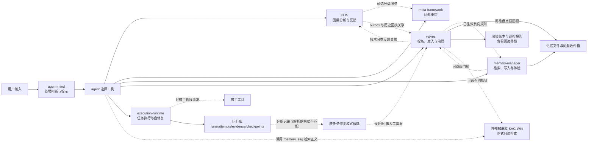

# DSH 心智系统

DSH 心智系统是一组供 DeepSeek Harness 使用的插件。它把**处境判断、因果分析、问题重审、跨会话记忆和规则治理**接到同一个宿主中，帮助 agent 在任务里选择分析方式、查找已有证据，并保留判断和反馈。

它提供的是工具、提示和可检查的记录：模型仍要理解具体问题并决定如何使用它们。工具存在、测试通过或探针返回正常，都不能单独证明某次任务取得了正确结果。

## 快速了解

| 组件 | 源码 | 主要职责 |
|---|---|---|
| **agent-mind** | [`packages/dsh-agent-mind/`](packages/dsh-agent-mind/) | 从用户输入判断处境并注入判断顺序；工具重排取决于宿主兼容性。 |
| **CLIS** | [`packages/dsh-clis/`](packages/dsh-clis/) | 根据输入判断因果结构，列出匹配的策略、记录反馈，并提供跨插件健康监督。 |
| **meta-framework** | [`packages/dsh-meta-framework/`](packages/dsh-meta-framework/) | 重定义问题、说明适用边界；可接入 CLIS 分类结果。 |
| **memory-manager** | [`packages/dsh-memory-manager/`](packages/dsh-memory-manager/) | 读写和检索长期记忆，执行层级写入判据、体检、问题收件箱和记忆面板。 |
| **valves** | [`packages/dsh-valves/`](packages/dsh-valves/) | 对上行、下行候选作准入判断，维护决策账本、负向规则及巡检。 |
| **execution-runtime** | [`packages/dsh-execution-runtime/`](packages/dsh-execution-runtime/) | 执行任务并按配方验收；记录异常分析，支持符合授权条件的原生模板重试。 |

[`packages/dsh-mind-system/`](packages/dsh-mind-system/) 是包含上述源码的**合成包**。它的 [`cordis.patch.yml`](packages/dsh-mind-system/cordis.patch.yml) 负责注册成员；包根入口主要提供清单和健康探针，具体能力在各成员中。合成包探针检查成员文件是否存在，**不等于**验证各成员已在真实宿主成功装载。

六个成员不是每次任务都依次运行的流水线。它们通过宿主服务、事件、工具调用和持久化数据协作；实际调用取决于宿主配置、用户请求及 agent 的判断。



上图用虚线表示可选交互及有条件或待接通的路径，旁注说明各路径状态。运行时可打开 **心智管理 → 实时架构** 查看记忆数据流。面板有 14 条连线，其中 13 条显示采集状态或近期活动，另有 1 条灰色实线表示手工登记。

| 在面板看到什么 | 如何解读 |
|---|---|
| 捕获 · 采集未启用 | 当前实例关闭了用户消息采集。启用后，箭头会区分等待样本、采集中、写入确认、重复、冲突和失败。最近结果保留 120 秒，过期后恢复灰色。 |
| 使用数据匹配 | 召回匹配器实际遍历了非空使用数据。是否改变了某条结果的排序，需要另行核对。 |
| 道 → 索引，标注“手工登记” | 这条实线说明索引行由人工维护。每日线索经蒸馏进入功能域，图上没有从每日线索直接写入索引的箭头。 |
| 活动箭头呈灰色虚线 | 查看箭头提示和活动数据状态。近期没有观测、观测已过期或数据源不可用，都可能使箭头呈灰色。 |

**架构证据与当前活动分开看**：`memory_read(kind=live_flow)` 返回有界的近期活动观测；未观测到事件不证明路径卡住，动画也不证明任务成功或采纳。`memory_read(kind=graph_evidence)` 和 `npm run verify-graph` 检查可关联的历史架构证据；历史匹配不代表当前活动，检查数也不等于主图边数。CLIS 生产端、回执和技术分类的关联不认证作者，也不证明人工采纳或原则归因。具体范围及后续验收见 [`UPGRADE-PLAN.md`](UPGRADE-PLAN.md)。

**SAG-Wiki 是宿主的正式只读检索通道。** 需要定位已整理的条目时可查看记忆索引，需要按词或日期查本地记忆时可用 `memory_search`，需要查一个或多个已注册目录的正文时可用 `memory_sag`。已知文件路径时可直接查阅原文。

`memory_sag` 的 `search` 返回带来源路径的片段，`paths` 和 `exclude` 可限定或排除目录。`status` 可查看已注册的目录及索引情况。引用片段时保留原文件的证据属性，正式记忆可用 `memory_read` 回查，项目文档和实验笔记按各自路径核对。

**索引召回提示。** 本版匹配器取查询中的汉字、英文字母和数字，计算其中有多少字符出现在候选索引行的名称或正文里。有有效字符且覆盖率低于 75% 时标记未命中。`hitTokens` 和 `missTokens` 解释哪些词匹配成功；字符覆盖率与实际带入的索引行数分别计算。[匹配判据](packages/dsh-memory-manager/src/recall.js)

## 安装与使用

需要可运行的 DSH 宿主，以及 Node.js 22 或更高版本。若合成包在当前包源中可用，可安装到指定 profile：

```bash
dsh plugin --profile web add dsh-mind-system
```

安装后按宿主的插件加载方式重新加载或重启，并实际调用工具核对。合成包已注册六个成员；不要同时启用同一成员的独立 bundle，否则可能重复注册。有关 DSH 命令，以本机 `dsh plugin --help` 为准。

在对话中可以从具体问题出发，例如：

- 调整反复无效时，提供观察现象，让 `clis_classify` 判断可能的因果结构；需要策略时再使用 `clis_plan` 或 `clis_run`。
- 想重新审视问题时，使用 `meta_reframe`；它是诊断工具，不代替用户决策或自动执行方案。
- 修改涉及既有约定的系统前，使用 `memory_read` 或 `memory_search` 查找记忆和来源。
- 想了解调度词与最近一次判断时，使用 `mind_signals`；想了解阀门账本时使用 `valve_metrics`。
- 想让 agent 执行一个有明确验收标准的任务时，直接描述任务与判据，由 `runtime_execute` 生成配方并逐步验收；先看 `runtime_verifiers` 了解可用的验收原语。

成员 README 提供使用说明。核对某个版本的完整参数和可用工具时，以该版源码的工具注册入口及已加载宿主的工具定义为准。

## 实际运行机制

### 1. 处境判断与编排

agent-mind 在宿主发出 `agent/inbox/claimed` 时读取用户输入并判定处境；对较旧宿主保留 `agent/pre-step` 路径。源码保留根据处境重排工具的逻辑，但 DSH 的 `system-prompt/assemble` 不向监听器提供工具列表，工具顺序由 provider 提供，因此本宿主上的监听器无法调整 provider 的工具顺序；没有可重排的列表或顺序未变时不记录已提供重排引导。重排设计不删除工具、核心工具保持原位，延后加载默认关闭；处境判断不保证模型调用某个工具，未知或歧义也不代表已正确分类。

信号注册表当前内置 15 条信号。外部插件可以通过事件贡献信号；能否在具体宿主装载顺序下收到，需以实际注册状态验证。采样仅针对非空输入；未命中或歧义样本可能保存经过规则脱敏、截断的输入摘要。脱敏是减少暴露的措施，不应视为绝对匿名化；设置 `DSH_MIND_SAMPLING=0` 可关闭采样。

主要实现：[`index.js`](packages/dsh-agent-mind/index.js)、[`dispatch.js`](packages/dsh-agent-mind/src/dispatch.js)、[`sampling.js`](packages/dsh-agent-mind/src/sampling.js)。

### 2. 因果分析与问题重审

CLIS 将分类、策略、反馈、编排拆为独立服务，并注册对应工具。分类器可能返回结构对偶、循环、单向、嵌套或 `unknown`；信息不足时不应把候选假设当成已证实因果。`clis_run` 记录调用方声明的上次干预结果。内置执行器对只读动作返回采集指令，对白名单内的写动作返回放行回执；实际外部干预仍需执行方实施。

meta-framework 的 `meta_reframe` 主要执行问题重定义和边界分析。四项因果回答齐全且分类服务可用时，可附带因果结构判断；它不自动完成用户任务。诊断路径与完整执行回退循环不同，记录 trace 也不等于证明干预已执行或有效。

主要实现：[`dsh-clis/index.js`](packages/dsh-clis/index.js)、[`dsh-meta-framework/src/tools.js`](packages/dsh-meta-framework/src/tools.js)。

### 3. 记忆与层级判据

memory-manager 默认使用 DSH 数据根下的 `memory/`；`DSH_HOME` 和插件配置可改变位置。索引、每日记录、功能域、原则、道、能力台账和宿主技能包的职责不同：

| 数据 | 存储与作用 |
|---|---|
| 索引 | `MEMORY.md` 保存概览和指针，供检索与召回定位。 |
| 每日记录 | 记忆根下 `YYYY-MM-DD.md`，保存原始事实和判断；可选的自动采集默认关闭。 |
| 术 | `functions/` 保存功能域的蒸馏结论；迭代块正文 ≤ 900 字，一行概括 ≤ 110 字。 |
| 法 | `insights/` 保存带来源和适用边界的原则。达到 ≥ 2 个**无关**来源域可归为“法”，只有一个来源或来源过于相近时可按“专项”保存。 |
| 道 | `dao/` 保存抽象命题；门槛包括 ≥ 5 条法萃取，并检查命题及正文形态。 |
| 器与技能 | `capabilities/` 记录外部能力；技能目录包位于宿主技能根，具有候选、启用、退役等状态。 |

写每日记录时按本次写入的当地日期选择文件。工具守卫拒绝新建非本机当日的日文件。日期守卫检查目标路径，无法判断追加到既有日期文件里的内容实际发生在哪一天。

写入工具的层级判据与落盘后自检实现分别在 [`layer-gate.js`](packages/dsh-memory-manager/src/layer-gate.js) 和 [`layer-selfcheck.js`](packages/dsh-memory-manager/src/layer-selfcheck.js)。`memory_write` 会读取指定日期的日记录或月归档，要求至少三个不同、可读且非空的素材日，并要求说明选日理由。只有一至两天时，必须填写规定类别和具体豁免事由；零天会被拒绝。素材与主题的相关性、豁免事由和结论由调用方说明。

召回的可选内容默认限制为 8192 个 UTF-8 字节，按完整条目取舍并标出省略；负向规则块不受该上限约束。这个限制既不是整条消息的硬上限，也不是模型 token 数；整体超时或规则服务不可用时，规则仍可能未送达。

`memory_check` 汇总结构、链接、大小、来源与账本问题，可投递到问题收件箱。`dao/_candidates/` 保存候选道，面板可查看。当前确认、否决和删除均在写入前返回 `safe_delete_unavailable`。`memory_dao` 的 `active` 路径仍可直接写正式道；宿主会话认证只核对会话身份。

每日采集源码已进入构建的合成包及连接安装；运行中服务是否加载特定版本须在实际宿主核对，构建和隔离测试不等于宿主验收，自动采集默认关闭，当前状态以现场查询为准。该路径仅在步骤获准进入后选择声明为 `role=user`、`source.kind=user` 且有稳定 ID 的消息，用 ID 标记去重；哈希、ID 和来源字段不能认证发送者，也不能保证采集不漏。历史每日正文不被自动改写；`resolve` 不勾改历史，改名和合并请求在改写前返回 `safe_rename_unavailable`，R10 读失败时报告范围未知，剩余死链数量仅是下界。

采集实现对参与同一协议的进程使用 SQLite 合作锁，写前核验账本基线并留下持久 pending 意图；崩溃后若意图未完成则停止后续采集，不自动补账或修复。架构页诊断区可展示本实例采集状态，但实例状态不是全局送达证明；文件、账本和其他副作用并非一体原子或天然幂等。历史每日文件可能未登记在账本中，缺口只能现场核查，不能补造来源。

**使用信号账本的存储布局**（`.usage/` 下按月分片，`.usage.jsonl` 单文件仍可读，两者一起读）：单文件会随时间不断增大，因此改为按月分片；超过 90 天的整月会被**降采样归档**到 `.usage/archive/`——`recall` 折成 `{href, 日, n}` 计数行（**曝光总数一个不少**，判据照旧），`read` / `correction` / `positive` 原样保留（各自有独立权重）。归档过程核对读取结果，并保留原始字节供核查；遇到无法确认的状态需人工对账，不能仅凭归档结果推断没有数据丢失。

**记忆面板**默认打开架构页，原独立概览入口已移除；诊断与最近改动位于架构页的可展开区域。页面接收活动与概览数据，流中断时使用轮询；新鲜度和活动指示只描述观测，不证明业务结果。源码界面、测试通过和正在运行的宿主页面分别需要核验。

**采集安全边界**：删除、重命名等入口因并发安全问题暂停，详见 [`UPGRADE-PLAN.md`](UPGRADE-PLAN.md)。`finishCaptureIntent` 当前源码先转移到隔离路径、核验身份，再按路径 `unlink`；核验与删除之间仍存在路径替换窗口（见 [`capture-intent-window-boundary.test.js`](packages/dsh-memory-manager/tests/capture-intent-window-boundary.test.js)）。追加式意图日志仍是隔离原型；该安全问题闭环前保持真实自动采集关闭，现场状态以实际查询为准。

新源码允许 `write` / `edit` 与 `str_replace_editor` 编辑记忆根顶层每日记录；提示词要求筛选可复用判断、取舍和经验，不抄日常执行流水。筛选依赖模型判断，不是硬性内容过滤。直接编辑不经过插件脱敏或账本登记，R26 可能报告不一致，后续自动采集可能因基线不匹配而停止；不得补造账本。层级目录、索引、顶层账本和宿主技能目录仍受工具守卫保护；shell、其他进程、旧版和其他非合作路径仍可绕过。R26 哈希不能证明真实来源或历史完整性。

主要实现：[`server.js`](packages/dsh-memory-manager/server.js)、[`write-guard.js`](packages/dsh-memory-manager/src/write-guard.js)、[`write-ledger.js`](packages/dsh-memory-manager/src/write-ledger.js)。

### 4. 阀门、提名和巡检

valves 将候选输入与判据裁决分开：`valve_check` 检查下行、上行、原则失效或语义标记；`valve_nominate` 从现有数据提名候选；`valve_metrics` 汇总已评估、放行和跳过的数据。判定结果不等同于规则自动生效；负向规则有单独确认和回退通道。

只读 `valve_usage_correlation` 以必填小写 UUIDv4 `correlationId` 有界核对 memory 与 valves 两侧记录，分别报告缺失、重复或读取不完整，并比较对象键、类型和备注。两侧快照非原子，来源未经认证；记录一致不证明采纳、效果或原则归因，也不具治理资格。查询不追加使用记录或写入规则。对端异步响应超时后不取消底层调用，直至调用结束前该插件不再发起新的对端查询；同步阻塞和事件循环停滞不受此超时约束。`memory_read(kind=adoption_evidence)` 的新分页游标绑定对象和所读来源内容；旧游标或来源变化需从首页重读，它不保证跨文件原子快照，也不认证反馈来源。

阈值集中在 [`thresholds.js`](packages/dsh-valves/src/thresholds.js)，目前是**暂定值**，应根据真实任务数据与反例校准，而不是把当前数字当作经过充分验证的科学常量。`valve_confirm` 的工具说明要求用户事先明确确认，但代码中的会话与工具调用本身不能证明真人授权；涉及规则生效时必须遵守这一操作约束。`valve_confirm` 除 `confirm` / `rollback` 外还支持 `action=sink`：把超过 `negativeRuleSinkDays`（默认 90 天，I-5/D3 定案）未触发的负向规则移出拦截，但**保留内容为反例资产**（不删除、`sunkNegativeRules` 可查回），写前快照因此可回退重新激活。命中流水在 `mind-rule-triggers.jsonl`；周检只报沉底候选，不代替人做去留决定。

定时巡检默认启用调度，但不代表默认输入齐全：周检的原则清单未配置时从记忆根 `insights/` 与决策账本枚举（每条带 `statement`），确实无输入才报告 `no_input`。每份周检报告都包含**召回边界段**：递归盘点配置的召回根（`_deleted` 标记目录永不入册）、与上一份报告对照报告新增主题；外部召回探针未配置或调用失败时 `violations` 记 `null`（未知），不冒充 0 违例。零引用条目只在引用证据足够（账本带 `principle_refs` 的行达到 `MIN_REFS_ROWS` 下限）时逐条点名，`refs_basis` 区分证据充分与不足。季度巡检缺少层统计回调时会跳过。应检查报告中的输入、状态和时间，不能把“定时器已注册”当作“内容已检查”。

周检还记录数据流证据覆盖；源码的架构页已移除运行时任务快照卡片，保留循环覆盖信息。缺失、读取失败、记录损坏与截断分别保留；任务的未决尝试只是待核查线索。调度投递、蒸馏结果和跨步骤关联缺乏对应证据时显示未知，历史观测不证明同一工作的闭环完成。报告文件写入失败会进入巡检错误状态。心智管理独立核对最近一份周报，将跨组件证据缺口与未决尝试作为候选写入收件箱，保存回执并在失败时重试；收件箱落盘不表示用户已经查看。周报同日覆盖、仅核对最新一份，以及多进程竞争的边界仍需注意。

**语义检查留痕。** 阀门可在同一决策账本追加独立的 `trace` 记录。层路径允许使用默认值，规则版本按规则 ID 取 `version`、`confirmed_at` 或占位值 `declared`。缺少嵌入模型时，对应检查记为 `skipped`。核对某次裁决时应分别查看裁决行与留痕行。[记录结构](packages/dsh-valves/src/trace.js)

**灰度放量（IV-1）**：新确认的规则以 `rollout: staged` 生效，**拦截力与 full 完全相同**，累积 `negativeRuleStagedHits`（默认 3）次真实命中后转 `full` 并记 `promoted_at`。转正只发生在真实命中路径（`matchNegative`），定时器与人工批量都不转正——那等于绕开证据；沉底优先，转正不复活已 `sunk` 的规则；读不到触发流水则一律不转正。放量进度是**正交字段**，不写进 `status`：`status` 是生命周期（active/sunk），被沉底、回滚和探针共同依赖，挪作灰度语义会连带改掉那些判断。

### 5. 任务执行与自修复

execution-runtime 的任务入口包括：`runtime_run` 执行宿主原生声明的任务模板；`runtime_status` 查询模板和已持久化的任务状态；`runtime_execute` 接受**运行时描述的任务**并由配方工厂生成可执行配方；`runtime_verifiers` 列出可用的验收与分支原语。配方复用、知识通道与模式提交分别使用 `runtime_recipes`、`runtime_knowledge`、`runtime_pattern`。

宿主同时注册 `runtime_write_json` 和 `runtime_write_text`，使生成配方可以实际写入产物。工具名使用下划线，以兼容严格模型 API。两个工具只能在挂载工作区内**新建**文件：现有目标及 `createOnly:false` 都拒绝；完整内容通过临时文件与硬链接发布，并发出现的目标也不会被替换。文件系统不支持硬链接时明确失败，不回退到覆盖写入。此机制不承诺断电持久性，也不防御同权限进程并发替换父目录。显式启用 `repair.replaceTool` 可另外注册 `runtime_replace_json`，仅在目标已有字节匹配 `expectedSha256` 时替换。修复派发还须满足模板与配方授权。

**三层结构：两层动态，一层守死。**

| 层 | 谁决定 | 动态程度 |
|---|---|---|
| 任务（目标、输入、截止） | 调用方运行时传入 | 完全动态 |
| 配方（怎么做这类活） | 从规格生成，支持单步、多步 `steps[]`、分支 `next[]` | 完全动态 |
| 验收（怎么算成功） | 从**闭合原语库**里选并参数化 | 词汇固定，参数动态 |

验收原语只有五个：`exact_bytes` / `line_set` / `structure` / `sorted_lines` / `json_fields`，分支条件只有 `file_exists` / `file_sha256` / `step_less_than` / `always`。**这一层刻意不放开**：若生成器能自行发明验收方式，它就能把失败重新描述成成功，自循环会退化成自证循环。未知原语在注册时报错，不静默降级。

其中 `sorted_lines` 与 `json_fields` 判断的是**关系**而不是产物自身：前者核对输出是否为输入的重新排列（重复行计数，不会被去重掩盖），后者核对字段值严格相等（`"3"` 不等于 `3`，不做类型强转）。这类关系型判据是必要的——只检查「看起来有序」或「形状正确」，任何恰好合法的产物都能通过。

`runtime_execute` 的调用方在提交规格时选择验收原语及预期值，运行时按已选判据检查。通过意味着产物满足该判据，任务目标是否实现还取决于判据如何定义。`runtime_run` 使用宿主预先注册的模板。

动态任务在等待分析时可生成并记录修复提议。原生模板显式开启 `autoRepair` 后，符合配方、权限和复核条件的 `retry_with` 才能重新准入、派发并由原验证器复核。跨任务模式查询返回按签名分组的记录，`taskId` 位于 `repairs[]` 内，而已接入的解析器读取顶层 `taskId`。这条持久记录复用路径目前会拒绝非空分组。独立的修复事件投递通道已接入 valves，可做技术核对。[原生修复入口](packages/dsh-execution-runtime/src/plugin.js)

两条边界值得注意：**未知副作用冻结**（不可逆或效应未知的动作不自动执行，停下核对）；**检查点带环境**（产生时的模板版本、范围、工作区任一项变化就不是合法回滚点）。

异常分析可复用宿主提供的 LLM 驱动；动态任务分析受 `analysis.allowDynamic` 控制。合成包的默认装载配置启用了该选项，并将 `tasks` 初始化为空；实际生成提议还需要可用的宿主模型服务。诊断原因走闭合词汇（`wrong_guess` / `environment_changed` / `wrong_expectation` / `unknown`），不接受自由文本：诊断要能被归类才能指导修复，散文不能。分析结果只是**提议**，不会自行派发任何动作。

运行库优先使用配置的 `stateDir`，其次使用 `DSH_HOME/execution-runtime`，两者均未指定时使用工作目录的 `.execution-runtime`；库文件名为 `runtime.sqlite`。`runtime_status` 报告 SQLite 主库路径的哈希标识，可用于比较报告的路径，但路径别名或数据库替换意味着它不能证明文件身份。探针报 `disabled` / `load-failed` 时不可用；`no-tasks` 只表示 `runtime_run` 没有预注册模板，`runtime_execute` 仍可处理运行时描述的任务。

**配方库（`runtime_recipes`）**把用过的配方规格存进同一个数据库，让后续任务可以按目标找回来而不是重新描述。它存的是**规格数据不是配方对象**——配方带可执行回调，把回调存进数据库意味着从库里加载代码，信任面远大于加载数据。三条边界：

- **复用不是先例。** 存下来的规格在下次使用时仍要重新构造、重新准入、重新由同一个验证器判定；"以前成功过"不构成验收理由，库不会变成一条绕过验收的捷径。
- `completed` 增加通过所选验证器的次数，`failed` 和 `cancelled` 增加失败次数。等待分析、阻塞和等待对账的任务均暂不计数。
- **只有成功过的配方才会被建议。** 只失败过的规格仍然留在库里（它可以被显式取用），但不会出现在 `runtime_recipes` 的推荐结果中，避免把已被证伪的做法伪装成可用。

建议匹配是**词面重叠**而非语义判断：让模型决定"这个配方适合那个目标"正是这一层不该自作主张的判断，所以它只返回候选供调用方查看，自身永不执行。

**运行时知识接口。** `runtime_knowledge` 接受域、知识 ID 和版本。默认适配器关闭；本版内置 SAG 适配器即使配置了连接参数，也因无法核实知识身份而返回 `knowledge_identity_unsupported`，读写请求停在本地。需要检索已注册目录正文时使用记忆插件的 `memory_sag`。[运行时适配器](packages/dsh-execution-runtime/src/knowledge-sag.js)

**阀门写入（`runtime_pattern`）**把已批准的修复模式提交到阀门规则库。这里有一条必须讲清的事实：`valve-bridge` 不传 `human` 标志、不传自己的许可票，但那**只证明它不主动声明**，不证明它没有能力——本仓库的 `valves.confirm()` 本身就是人工通道，内部会自行签票。所以真正的人工闸门位置在**宿主传入哪个写入函数**：直接传 `valves.confirm` 等于把人的权限交给运行时；传一个"无人在场就拒绝"的包装才保持了闸门。运行时无法分辨两者，因此这一条只能写在文档里，而不是靠代码保证。

运行时能保证的是：没有已确认、未过期、版本匹配的批准就拒绝；模式正文取自宿主注册表而非请求（调用方可以点名，不能描述规则）；写入被拒或抛错都如实报失败。

**主动介入（`tools/post-execute`）**：运行时监听每次工具执行的结果，在**同一失败重复出现**时追加一段可选上下文，说明它能提供什么。三条边界：

- **只提供，不决定。** 提示说明能力并明说"不一定要用"，不声称任务失败、不指定修复；是否采用完全由宿主判断。
- 默认同一相关失败出现两次才触发提示；阈值显式设为 1 时，首次相关失败即可触发。不相关的失败和冷却期内的重复会跳过。
- **指标成对报。** `evaluated` / `hinted` / `skipped` / `skippedByReason` / `missRate` 一起给；只报提示次数无法区分"没在说话"和"没在看"。

这是运行时"被宿主知道存在"的方式：它不接管任务路由，只在一个真的可能有用的时刻出声。

### 6. 从反馈到迭代

当前代码提供以下环节，但不是一个无条件自动完成的自进化系统。`object_trace` 可按对象查看写入、索引、召回、读取和反馈记录；`positive` / `correction` 是调用方声明，匹配记录不认证身份，也不证明采纳、目标达成或原则归因。关联 ID 重复时标为歧义；反馈与相关写入并非跨存储原子提交，未确认且不具治理资格：

1. **观察**：保留用户反馈、真实失败、工具结果和可复查的任务证据。
2. **提名**：从使用记录或失败记录中生成候选；候选尚未生效。
3. **检验**：检查来源、反例、覆盖范围和与已有规则的冲突；不足时保留不确定状态。
4. **决策**：按规则类型走现有写入或确认通道；涉及人的授权时，以实际可信授权为准。
5. **复验**：在新任务中观察实际收益、漏判与误判；必要时修订、回退或退役。

架构概览的 `closureEvidence` 根据短时窗口中的召回完成、工具进行中和工具完成事件生成。当前概览调用没有传入任务标识或复核答案，因此只能显示这些事件是否出现，无法据此关联同一任务或确认复核。`memory_read(kind=live_flow)` 在本版返回活动边和丢弃计数。后续验收见 [迭代计划](UPGRADE-PLAN.md)。

## 仓库与开发

```text
packages/
  dsh-agent-mind/       编排、信号、采样
  dsh-clis/             因果服务与工具
  dsh-meta-framework/   重审工具与适配
  dsh-memory-manager/   记忆服务、面板与测试
  dsh-valves/           阀门、账本、巡检
  dsh-execution-runtime/ 任务执行、配方工厂、验收原语
  dsh-mind-system/      由源包构建的合成包
scripts/
  build-combined.mjs    构建合成包成员
  verify-combined.mjs   校验产物与源包一致
  install-profile.mjs   拷贝并替换 profile 中的安装目录
UPGRADE-PLAN.md          后续迭代计划
```

修改源包后，在仓库根目录执行：

```bash
npm run build
npm run verify-combined
npm test
```

完整测试包含文档、计划、子包结构、合成包测试和发布检查。部分集成测试需要定位真实 DSH 安装；例如本机 PowerShell 可设置：

```powershell
$env:DSH_INSTALL_DIR = '<absolute-path-to-DSH-installation>'
$env:DSH_REQUIRE_HOST = '1'
npm test
```

根测试命令会运行合成包、agent-mind、meta-framework、valves 和 memory 的测试，以及记忆面板的宿主、API、UI 检查。独立运行时套件可用 `npm --prefix packages/dsh-execution-runtime test`，CLIS 事件存储用 `node --test packages/dsh-clis/clis-event-store.test.js`。SAG 现场测试需显式设置 `DSH_TEST_LIVE_SAG=1`。

### 构建和安装边界

- `npm run build` 按 [`build.manifest.json`](packages/dsh-mind-system/build.manifest.json) 把源包内容生成到合成包；手改生成目录不是持久修改。
- 如果 profile 中安装目录是指向仓库产物的 junction，构建会直接改变运行实例的磁盘文件；是否即时生效取决于宿主模块加载与热重载，不应仅凭构建成功推断。
- `node scripts/install-profile.mjs --dry-run` 只预览目标。实际执行会先生成拷贝，再**替换**目标安装目录；它不是创建 junction 的命令，且应先核对目标与备份。该脚本在删除旧目标后再重命名新目录，不能承诺任意失败情况下旧安装一定仍在。
- [`switch-to-junction.mjs`](scripts/switch-to-junction.mjs) 包含本机路径和宿主停启逻辑，不是通用安装命令。
- 服务端改动的生效方式依实际装载方式而定；如果使用面板热重载，要检查请求结果，并用真实工具调用验证。页面改动还需按宿主 Web 构建和刷新机制验证。

## 检查与边界

### memory-manager · 29 条

以下代号按当前 `memory_check` 与联邦检查源码中的 `add(...)` 统计；单个代号可能覆盖多种情形，完整逻辑以源码为准。

| 范围 | 代号 | 检查方向 |
|---|---|---|
| 入口与索引 | `R0` `R3` `R5` `R14` `R15` | 索引存在、摘要、日期、长度、重复内容等。 |
| 功能文件与链接 | `R8` `R9` `R10` `R10e` `R13` `R16` `TEMP` | 反向引用、文件大小、失效或越界链接、历史区、路径及冷记忆。 |
| 使用与技能 | `R18` `R19` `R20` `R20e` `R21` `R22` | 纠正率、共识、技能布局和状态、凭据或标识，以及原则信任信号。 |
| 原则、道与审计 | `R23` `R24` `R25` `R26` `R27` | 原则预算与使用证据、道层完整性、曾有使用证据的文件消失、写入对账和折叠冗余。 |
| 蒸馏候选 | `R28` | 从顶层日记录和月归档中查找可能相关的段落，同时保留多主题命中。用 `memory_distill_review(action=list)` 定位原文，核查后以 `review` 提交该素材版本的结论，之后可用 `receipt` 查回。同一版本审过后退出待审，素材变化后重新提示。读取不全时保留提示。 |
| 联邦 | `F1` `F2` `F3` `F4` `F5` | 联邦索引、来源、副本与路径；仅配置联邦时适用。 |

体检输出是待核查线索：历史未登记、合法重命名、权限问题、账本损坏和真实异常可能产生不同或相似信号。确认原因前不要自动删除、重写或宣布合规。

### 统计口径

[`verify-readme.mjs`](scripts/verify-readme.mjs) 检查体检代号、部分层级门槛和内置信号数。工具名检查按五个成员的指定源码文件扫描，并核对其子包文档；运行时工具和拆到其他模块注册的工具不在这项扫描内。功能是否已经接通，需另查宿主注册、调用路径及对应测试。

## 许可

合成包采用 [MIT 许可证](packages/dsh-mind-system/LICENSE)。
