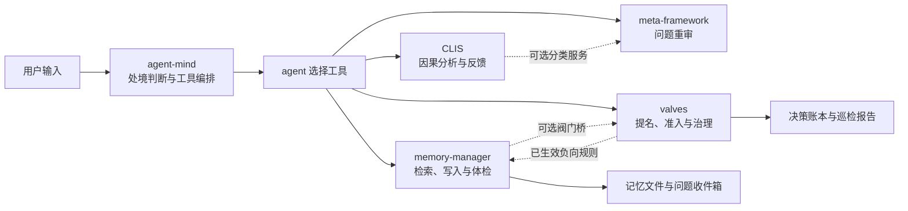

# DSH 心智系统

DSH 心智系统是一组供 [DeepSeek Harness](https://github.com/deepseek-ai) 使用的插件。它把**处境判断、因果分析、问题重审、跨会话记忆和规则治理**接到同一个宿主中，帮助 agent 在任务里选择分析方式、查找已有证据，并保留判断和反馈。

它提供的是工具、提示和可检查的记录：模型仍要理解具体问题并决定如何使用它们。工具存在、测试通过或探针返回正常，都不能单独证明某次任务取得了正确结果。

## 快速了解

| 组件 | 源码 | 主要职责 |
|---|---|---|
| **agent-mind** | [`packages/dsh-agent-mind/`](packages/dsh-agent-mind/) | 从用户输入判断处境、注入判断顺序、按处境调整工具展示顺序。 |
| **CLIS** | [`packages/dsh-clis/`](packages/dsh-clis/) | 根据输入判断因果结构，列出匹配的策略、记录反馈，并提供跨插件健康监督。 |
| **meta-framework** | [`packages/dsh-meta-framework/`](packages/dsh-meta-framework/) | 重定义问题、说明适用边界；可接入 CLIS 分类结果。 |
| **memory-manager** | [`packages/dsh-memory-manager/`](packages/dsh-memory-manager/) | 读写和检索长期记忆，执行层级写入判据、体检、问题收件箱和记忆面板。 |
| **valves** | [`packages/dsh-valves/`](packages/dsh-valves/) | 对上行、下行候选作准入判断，维护决策账本、负向规则及巡检。 |

[`packages/dsh-mind-system/`](packages/dsh-mind-system/) 是包含上述源码的**合成包**。它的 [`cordis.patch.yml`](packages/dsh-mind-system/cordis.patch.yml) 负责注册成员；包根入口主要提供清单和健康探针，具体能力在各成员中。合成包探针检查成员文件是否存在，**不等于**验证各成员已在真实宿主成功装载。

五个成员不是每次任务都依次运行的流水线。它们通过宿主服务、事件、工具调用和持久化数据协作；实际调用取决于宿主配置、用户请求及 agent 的判断。



虚线表示可选交互，箭头不表示每轮必经顺序。缺少服务时的具体降级方式以各成员代码和配置为准。

## 安装与使用

需要可运行的 DSH 宿主，以及 Node.js 22 或更高版本。若合成包在当前包源中可用，可安装到指定 profile：

```bash
dsh plugin --profile web add dsh-mind-system
```

安装后按宿主的插件加载方式重新加载或重启，并实际调用工具核对。合成包已注册五个成员；不要同时启用同一成员的独立 bundle，否则可能重复注册。有关 DSH 命令，以本机 `dsh plugin --help` 为准。

在对话中可以从具体问题出发，例如：

- 调整反复无效时，提供观察现象，让 `clis_classify` 判断可能的因果结构；需要策略时再使用 `clis_plan` 或 `clis_run`。
- 想重新审视问题时，使用 `meta_reframe`；它是诊断工具，不代替用户决策或自动执行方案。
- 修改涉及既有约定的系统前，使用 `memory_read` 或 `memory_search` 查找记忆和来源。
- 想了解调度词与最近一次判断时，使用 `mind_signals`；想了解阀门账本时使用 `valve_metrics`。

各成员的完整工具名、参数和限制分别维护在对应子包的 README 中；以运行中宿主实际暴露的工具定义为准。

## 实际运行机制

### 1. 处境判断与编排

agent-mind 在宿主发出 `agent/inbox/claimed` 时读取用户输入并判定处境；对较旧宿主保留 `agent/pre-step` 路径。`system-prompt/assemble` 阶段可据此调整工具展示顺序。调度不保证模型一定调用某个工具；未知或无法判定的输入也不应被解释为已正确分类。

信号注册表当前内置 14 条信号。外部插件可以通过事件贡献信号；能否在具体宿主装载顺序下收到，需以实际注册状态验证。采样仅针对非空输入；未命中或歧义样本可能保存经过规则脱敏、截断的输入摘要。脱敏是减少暴露的措施，不应视为绝对匿名化；设置 `DSH_MIND_SAMPLING=0` 可关闭采样。

主要实现：[`index.js`](packages/dsh-agent-mind/index.js)、[`dispatch.js`](packages/dsh-agent-mind/src/dispatch.js)、[`sampling.js`](packages/dsh-agent-mind/src/sampling.js)。

### 2. 因果分析与问题重审

CLIS 将分类、策略、反馈、编排拆为独立服务，并注册对应工具。分类器可能返回结构对偶、循环、单向、嵌套或 `unknown`；信息不足时不应把候选假设当成已证实因果。`clis_run` 接受上次干预的实际结果，供后续判断使用；写动作默认受执行器限制。

meta-framework 的 `meta_reframe` 主要执行问题重定义和边界分析。四项因果回答齐全且分类服务可用时，可附带因果结构判断；它不自动完成用户任务。诊断路径与完整执行回退循环不同，记录 trace 也不等于证明干预已执行或有效。

主要实现：[`dsh-clis/index.js`](packages/dsh-clis/index.js)、[`dsh-meta-framework/src/tools.js`](packages/dsh-meta-framework/src/tools.js)。

### 3. 记忆与层级判据

memory-manager 默认使用 DSH 数据根下的 `memory/`；`DSH_HOME` 和插件配置可改变位置。索引、每日记录、功能域、原则、道、能力台账和宿主技能包的职责不同：

| 数据 | 存储与作用 |
|---|---|
| 索引 | `MEMORY.md` 保存概览和指针，供检索与召回定位。 |
| 每日记录 | 记忆根下 `YYYY-MM-DD.md`，保存原始事实和判断；可选的自动采集默认关闭。 |
| 术 | `functions/` 保存功能域的蒸馏结论；迭代块正文 ≤ 900 字，一行概括 ≤ 110 字。 |
| 法 | `insights/` 保存可跨域重用的原则；门槛包括 ≥ 2 个**无关**来源域及适用边界。 |
| 道 | `dao/` 保存抽象命题；门槛包括 ≥ 5 条法萃取，并检查命题及正文形态。 |
| 器与技能 | `capabilities/` 记录外部能力；技能目录包位于宿主技能根，具有候选、启用、退役等状态。 |

写入工具的层级判据与落盘后自检实现分别在 [`layer-gate.js`](packages/dsh-memory-manager/src/layer-gate.js) 和 [`layer-selfcheck.js`](packages/dsh-memory-manager/src/layer-selfcheck.js)。每日素材与功能域蒸馏之间的使用纪律见实际宿主配置；`memory_write` 仍接收调用者提供的正文，插件写入本身不能证明内容是从可信素材抽取，也不能自动证明文本结论真实。

召回的可选内容默认限制为 8192 个 UTF-8 字节，按完整条目取舍并标出省略；负向规则块不受该上限约束。这个限制既不是整条消息的硬上限，也不是模型 token 数；整体超时或规则服务不可用时，规则仍可能未送达。

`memory_check` 汇总结构、链接、大小、来源与账本等问题，并可将发现投递到问题收件箱。候选道保存在 `dao/_candidates/`，面板提供查看、确认、否决和删除操作；确认前候选不应作为已生效的道使用。**当前认证只验证会话，无法单独证明操作由真人点击；现有 `memory_dao` 的 active 路径也可直接写正式道。** 因此人工确认仍依赖操作纪律，不能宣称已有不可绕过的人类身份闸门。

当前共享源码中的每日采集改动仅在隔离环境验证，**尚未构建、部署或在真实宿主验收**；真实采集开关维持关闭。该路径只在步骤获准进入后选择声明为 `role=user`、`source.kind=user` 且有稳定 ID 的消息，用 ID 标记去重；哈希、ID 和来源字段都不能认证发送者，也不能保证采集不漏。历史每日正文不被自动改写；`resolve` 不勾改历史，`memory_rename` 跳过历史每日链接，R10 读失败时报告范围未知，剩余死链数量仅是下界。

隔离实现对参与同一协议的采集进程使用 SQLite 合作锁（Node 22 的 `node:sqlite` 为实验性功能），写前核验账本基线并留下持久 pending 意图；崩溃后若意图未完成则停止后续采集，不自动补账或修复。概览可展示本实例采集状态及待处理意图，但实例状态不是全局送达证明；文件、账本和其他副作用并非一体原子或天然幂等。此前只读检查发现 13 份历史每日文件未登记，不能补造来源。

**发布阻断状态（2026-11-14 更新）**：面板 exclusive 归档提交已修复——暂存移入记忆根下 `.stage/`，创建时记录 `(dev, ino)`，提交后仅在 inode 核验一致时删除；确认、否决、删除流程真机验证恢复（API ALL PASS，热重载后 `memory_check` 0 FAIL）。`finishCaptureIntent` 也已改为 inode 核验删除，「调用前被替换」的反例已消除。**仍剩一条**：「unlink 瞬间被替换」——替换注入在 unlink 内部、必然晚于任何核验，而 Node 公共 API 没有按句柄删除的原语，属 check-then-act 窗口（`tests/capture-intent-window-boundary.test.js` 把该结论做成了可证伪的机器事实）。红测保留在总入口、未削弱断言。追加式意图日志仍仅为隔离原型，可信初始化、旧意图迁移与生产接入未完成；该问题闭环前不得启用真实自动采集，也不得把采集路径称为已修复。

新源码允许 `write` / `edit` 与 `str_replace_editor` 编辑记忆根顶层每日记录；提示词要求筛选可复用判断、取舍和经验，不抄日常执行流水。筛选依赖模型判断，不是硬性内容过滤。直接编辑不经过插件脱敏或账本登记，R26 可能报告不一致，后续自动采集可能因基线不匹配而停止；不得补造账本。层级目录、索引、顶层账本和宿主技能目录仍受工具守卫保护；shell、其他进程、旧版和其他非合作路径仍可绕过。R26 哈希不能证明真实来源或历史完整性。

主要实现：[`server.js`](packages/dsh-memory-manager/server.js)、[`write-guard.js`](packages/dsh-memory-manager/src/write-guard.js)、[`write-ledger.js`](packages/dsh-memory-manager/src/write-ledger.js)。

### 4. 阀门、提名和巡检

valves 将候选输入与判据裁决分开：`valve_check` 检查下行、上行、原则失效或语义标记；`valve_nominate` 从现有数据提名候选；`valve_metrics` 汇总已评估、放行和跳过的数据。判定结果不等同于规则自动生效；负向规则有单独确认和回退通道。

阈值集中在 [`thresholds.js`](packages/dsh-valves/src/thresholds.js)，目前是**暂定值**，应根据真实任务数据与反例校准，而不是把当前数字当作经过充分验证的科学常量。`valve_confirm` 的工具说明要求用户事先明确确认，但代码中的会话与工具调用本身不能证明真人授权；涉及规则生效时必须遵守这一操作约束。`valve_confirm` 除 `confirm` / `rollback` 外还支持 `action=sink`：把超过 `negativeRuleSinkDays`（默认 90 天，I-5/D3 定案）未触发的负向规则移出拦截，但**保留内容为反例资产**（不删除、`sunkNegativeRules` 可查回），写前快照因此可回退重新激活。命中流水在 `mind-rule-triggers.jsonl`；周检只报沉底候选，不代替人做去留决定。

定时巡检默认启用调度，但不代表默认输入齐全：周检需要原则清单、候选来源或对应回调；未提供输入会报告 `no_input`。季度巡检缺少层统计回调时会跳过。应检查报告中的输入、状态和时间，不能把“定时器已注册”当作“内容已检查”。

### 5. 从反馈到迭代

当前代码提供以下环节，但不是一个无条件自动完成的自进化系统：

1. **观察**：保留用户反馈、真实失败、工具结果和可复查的任务证据。
2. **提名**：从使用记录或失败记录中生成候选；候选尚未生效。
3. **检验**：检查来源、反例、覆盖范围和与已有规则的冲突；不足时保留不确定状态。
4. **决策**：按规则类型走现有写入或确认通道；涉及人的授权时，以实际可信授权为准。
5. **复验**：在新任务中观察实际收益、漏判与误判；必要时修订、回退或退役。

代码中存在的提名器、账本、体检和规则生命周期为这条链提供部件；真实样本量不足、证据链不全或缺少可信确认时，应明确标为待验证。当前路线和节点状态见 [`UPGRADE-PLAN.md`](UPGRADE-PLAN.md)。

## 仓库与开发

```text
packages/
  dsh-agent-mind/       编排、信号、采样
  dsh-clis/             因果服务与工具
  dsh-meta-framework/   重审工具与适配
  dsh-memory-manager/   记忆服务、面板与测试
  dsh-valves/           阀门、账本、巡检
  dsh-mind-system/      由源包构建的合成包
scripts/
  build-combined.mjs    构建合成包成员
  verify-combined.mjs   校验产物与源包一致
  install-profile.mjs   拷贝并替换 profile 中的安装目录
UPGRADE-PLAN.md          阶段、节点和验收状态
```

修改源包后，在仓库根目录执行：

```bash
npm run build
npm run verify-combined
npm test
```

完整测试包含文档、计划、子包结构、合成包测试和发布检查。部分集成测试需要定位真实 DSH 安装；例如本机 PowerShell 可设置：

```powershell
$env:DSH_INSTALL_DIR = 'D:/dsh'
$env:DSH_REQUIRE_HOST = '1'
npm test
```

根据实际安装路径调整环境变量。测试退出码为零表示该测试集通过，不能代替运行中的宿主端到端验证。

### 构建和安装边界

- `npm run build` 按 [`build.manifest.json`](packages/dsh-mind-system/build.manifest.json) 把源包内容生成到合成包；手改生成目录不是持久修改。
- 如果 profile 中安装目录是指向仓库产物的 junction，构建会直接改变运行实例的磁盘文件；是否即时生效取决于宿主模块加载与热重载，不应仅凭构建成功推断。
- `node scripts/install-profile.mjs --dry-run` 只预览目标。实际执行会先生成拷贝，再**替换**目标安装目录；它不是创建 junction 的命令，且应先核对目标与备份。该脚本在删除旧目标后再重命名新目录，不能承诺任意失败情况下旧安装一定仍在。
- [`switch-to-junction.mjs`](scripts/switch-to-junction.mjs) 包含本机路径和宿主停启逻辑，不是通用安装命令。
- 服务端改动的生效方式依实际装载方式而定；如果使用面板热重载，要检查请求结果，并用真实工具调用验证。页面改动还需按宿主 Web 构建和刷新机制验证。

## 检查与边界

### memory-manager · 28 条

以下代号按当前 `memory_check` 与联邦检查源码中的 `add(...)` 统计；单个代号可能覆盖多种情形，完整逻辑以源码为准。

| 范围 | 代号 | 检查方向 |
|---|---|---|
| 入口与索引 | `R0` `R3` `R5` `R14` `R15` | 索引存在、摘要、日期、长度、重复内容等。 |
| 功能文件与链接 | `R8` `R9` `R10` `R10e` `R13` `R16` `TEMP` | 反向引用、文件大小、失效或越界链接、历史区、路径及冷记忆。 |
| 使用与技能 | `R18` `R19` `R20` `R20e` `R21` `R22` | 纠正率、共识、技能布局和状态、凭据或标识，以及原则信任信号。 |
| 原则、道与审计 | `R23` `R24` `R25` `R26` `R27` | 原则预算与使用证据、道层完整性、曾有使用证据的文件消失、写入对账和折叠冗余。 |
| 联邦 | `F1` `F2` `F3` `F4` `F5` | 联邦索引、来源、副本与路径；仅配置联邦时适用。 |

体检输出是待核查线索：历史未登记、合法重命名、权限问题、账本损坏和真实异常可能产生不同或相似信号。确认原因前不要自动删除、重写或宣布合规。

### 统计口径

测试数量随源码变化，不在本文固定。测试退出结果只说明运行过的用例结果，不证明实际宿主效果或覆盖所有写入路径。现有 [`verify-readme.mjs`](scripts/verify-readme.mjs) 仍要求本文提供固定测试与行数表，与本段口径不一致；在校验脚本同步前，该项文档校验不能通过。

## 许可

MIT。各成员的许可文件位于对应包目录。
