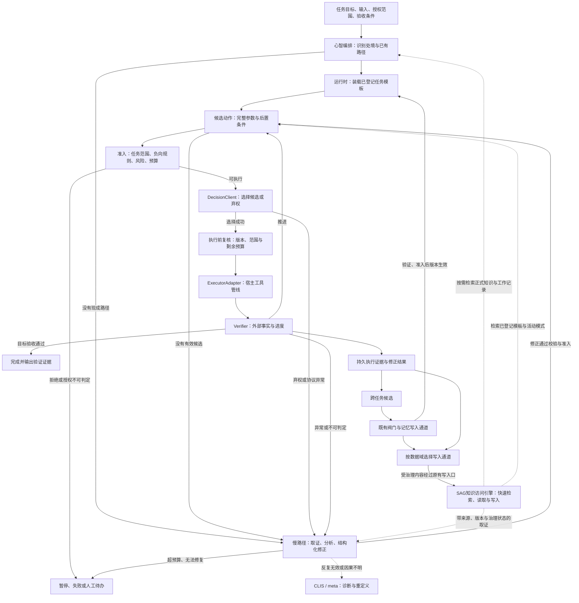

# 心智系统 × 双循环执行运行时：融合开发方案与计划

> 版本：v1.15 · 2026-11-17；DL-4.3命中/弃权/撤销/回退取得隔离证据；知识读写与合成构建仍待做。
> 性质：开发方案与逐步执行记录；隔离验证不等于活动宿主部署或真实任务验收。执行进展见[阶段0](runtime-phase0-evidence.md)、[阶段1](runtime-phase1-evidence.md)、[阶段2·异常闭环](runtime-phase2-evidence.md)、[阶段3·恢复核对](runtime-phase3-evidence.md)与[阶段4·模式候选](runtime-phase4-evidence.md)。
> 关联：[现有升级计划](../UPGRADE-PLAN.md)。原计划 I–VI、F1–F19、N1–N6 保留原义；本文使用 DL 节点和 DR 验收编号，不覆盖原编号、不把组件存在记为执行闭环完成。
> 基线：心智系统仓库 `28029f9`；本机 Node.js `v22.23.3`。开发工作树为 `D:/个人开发/dsh-execution-runtime`，分支 `feat/dual-loop-runtime`。已运行隔离协议、真实安装包管线和持久化原型测试；尚未验证真实Jev服务或部署完整运行时。

## 1. 目标与适用范围

### 1.1 核心目标

已有可执行路径、动作满足准入、结果能够验证时，默认执行；路径缺失、证据不足或执行异常时，才升级分析。分析产出修正建议，运行时负责校验、准入、执行和验证，经过验证的经验才进入推广候选。

本方案改变的是宿主侧的模型调用和工具执行组织方式，不改变任何模型内部的自回归机制。阶段一先证明一个任务内部的正常步骤能够不调用推理模型；完整会话的任务理解和结果表达调用另行计量。

### 1.2 首版覆盖

- 有明确输入输出、有限分支、确定后置条件的单任务流程。
- 首例：临时工作区中的结构化文件转换与校验。输入、产物范围和期望结构由任务模板声明。
- 第二例：只读诊断流程，根据已知错误码选择检查动作并验证目标事实。
- 第三例：受范围约束的文件修改，需有原内容版本检查、幂等或补偿契约，通过前两例后再接入。

开放式研究、首次复杂功能实现、创造性产物可以请求慢路径构造新计划，但不承诺这些任务有低于 20% 的推理调用比例。首版不自动执行任意 Markdown 技能、不把模型生成脚本直接变成已授权程序。

### 1.3 非目标

首版不训练模型，不建设多租户，不引入 Python 常驻服务、LangGraph、Redis 或 PostgreSQL，不接管现有 Web 会话的默认 Agent 工厂。跨任务经验仍走既有记忆与阀门体系。

## 2. 已核对的实际基础

| 能力 | 已见事实与证据 | 融合决策 |
| :--- | :--- | :--- |
| 心智编排 | [mind 入口](../packages/dsh-agent-mind/index.js) 注入判断顺序、调整工具面并按 agent 维护处境 | 复用处境与信号，不将其当作自动执行器 |
| 约束模块 | [constraints](../packages/dsh-agent-mind/src/constraints.js) 有 allow/deny/unavailable 合成；模块明确写首版只读 | 可复用判据，执行侧消费与记账需要新接线；空约束不等于授权 |
| meta | [meta 入口](../packages/dsh-meta-framework/index.js) 暴露诊断工具；有意不暴露原有完整自动回退循环 | 复用重定义能力，不恢复已经证明不适用的旧自动循环 |
| valves 服务 | [valves 入口](../packages/dsh-valves/index.js) 提供 downward/upward、matchNegative、semanticCheck、govern 等接口 | 通过服务适配器复用裁决；不从外部调用人工确认函数冒充用户确认 |
| 治理预算 | [budget](../packages/dsh-valves/src/budget.js) 主要限制批量条目与账本行数 | 新增运行时步数、工具调用、模型调用、耗时预算；不把 maxItems 当执行步数 |
| 规则回滚 | 原计划 III-4 是负向规则库的写前快照与版本回退 | 不等同于工具副作用回滚，新增独立恢复契约 |
| LayerTrace | [trace](../packages/dsh-valves/src/trace.js) 有层路径、规则版本、预算、闸门结果；预算归一化目前是 items/rows | 复用治理字段；运行时预算另设字段。现有写入是 best-effort，不作为执行持久化成功凭据 |
| 记忆治理与SAG引擎 | 现有记忆管理层负责组织、准入与生命周期；SAG的生态角色是快速检索与读写引擎，本机已验证文件写入→索引→检索闭环 | 通过知识访问适配器提供查询、读取、写入与收录确认；可服务正式知识、工作记录和碰撞区，内容效力由所属域与版本决定，不因经过SAG而降为实验材料 |
| 合成与发布 | [成员声明](../packages/dsh-mind-system/build.manifest.json) 已有五个源包；[构建脚本](../scripts/build-combined.mjs) 生成合成目录 | 新代码进入独立源包，完成后加入成员声明；不在合成目录开发 |
| 当前安装 | profile 配置指向合成包目录并监听成员；构建脚本明确警告 junction 构建可能直接影响运行实例 | 运行时代码先在隔离工作树/测试 profile 开发；加载验收前不写活动合成目录 |
| 宿主工具管线 | 本机 ToolRuntime 有公开 execute，包含 pre-policy、guards、around、post、result | 宿主适配器通过公开管线执行，禁止直接调用工具定义的 execute |
| 宿主 Agent 工厂 | AgentRegistry 有 setFactory，但已有工厂时抛错；AgentFactory 要实现 create/resume 生命周期 | 后期可做独立 profile 的替代循环提供者；首版不抢占运行中的全局工厂 |
| Jev 参考实现 | SAG 源码使用 state + questions 对象、noul 候选评分；本机代码还包含不同供应商的协议转换 | 先做独立 DecisionClient 适配；不把原文 choice/confidence/distribution 视为已验证协议 |

现有计划部分历史说明与较新的代码/每日记录存在时序差异。例如 V-1 节点已有 LayerTrace，而汇总仍有“待 V-1”的表述；采集和 SAG 自动启动也有旧说明。本文引用具体实现，不顺手修改旧验收状态。开发准备阶段只修复能够用源码与观测证明的文档矛盾，真实闭环仍待观测的项保持开放。

## 3. 融合架构



心智系统负责处境、约束和经验治理；执行运行时负责当前任务的状态机与动作推进。快路径和异常修复构成运行时双循环，现有原则治理仍在跨任务层运行。层级不变：既有上行方向是 L3→L0，下行相反；一个工具步骤不会被伪装成每次都经过四层。

## 4. 技术决策与代码落点

### 4.1 采用 Node.js / ESM，与现有测试和装配一致

新增源包暂定 `packages/dsh-execution-runtime/`，采用 JavaScript ESM + JSDoc + JSON Schema；文档可用 TypeScript 接口表达契约。沿用 `node:test`，不为单一成员迁移整个仓库到 TypeScript。代码注释、模型执行指令与脚本指令使用英文；设计说明与经验总结使用中文。

建议目录如下，均为待创建内容：

```text
packages/dsh-execution-runtime/
  index.js
  src/
    contracts.js
    scheduler.js
    candidates.js
    admission.js
    decision-client.js
    executor.js
    verifier.js
    analyzer.js
    recovery.js
    store.js
    repair-patterns.js
    host-adapter.js
    health.js
  recipes/
  test/
  README.md
```

完成源包隔离验收后，更新合成成员声明、导出与文件列表、装配 patch、测试总入口及结构/发布守卫。默认配置 `enabled:false`，只对明确选择运行时的任务开启。

### 4.2 两级接入

| 级别 | 方式 | 边界与交付 |
| :--- | :--- | :--- |
| 首版：任务级运行时 | 普通 Agent 调用 `runtime_run`，内部执行有界任务模板；另提供 status/pause/resume/cancel | 外层任务理解和最后表达仍可能调用模型；内部正常步骤无推理模型调用。子调用经过宿主管线并有独立关联记录 |
| 后续：原生循环提供者 | 在独立测试 profile 通过 AgentFactory 装配新的创建/恢复实现 | 要完成 Agent 生命周期、输入队列、持久化、取消、会话投影与 Web 兼容；不得热替换活动 Web profile 的工厂 |

首版不是“整个聊天系统已经切换为异常驱动”。必须分别展示运行时内部调用数与整段会话调用数。

宿主核对到公开 ToolRuntime.execute，并不代表原生会话事件自动持久化、PTC 嵌套、调用归属和预算传播已验证。DL-0 必须做真实管线接缝测试；缺少所需父调用上下文时，只使用隔离原生模式测试，不伪造 parent token 绕过模式限制。

### 4.3 SAG作为知识访问基础设施

SAG的角色是快速检索与读写引擎，数据的用途和治理状态由业务域决定。正式知识、原始记录、活动修正模式与碰撞笔记都可以使用同一引擎访问；“实验”描述的是某个内容域，不是SAG本身。经SAG返回的正式内容仍按原有正式身份使用，不能一律降为线索；未经验证的笔记也不因被索引就自动获得正式身份。

新增 `KnowledgeAccessAdapter`，提供以下逻辑接口；这些是本方案的适配契约，不声称SAG当前HTTP API已逐项提供：

| 接口 | 作用 | 验收约束 |
| :--- | :--- | :--- |
| search | 按任务范围检索正式知识、模板、模式或工作记录 | 结果保留来源、内容域、版本与生命周期；不能从高相关度推出有效性 |
| read | 按对象标识读取指定内容 | 需要可核验版本时回到所属域核对，无法核对如实返回unknown |
| write | 在指定内容域写入或更新 | 任务范围和所属域写入规则生效；正式记忆仍经过既有写入工具，工作区文件使用其授权写入通道 |
| indexStatus | 确认指定版本是否被索引 | 区分写入成功、收录完成和当前可检索，不能用“有近邻命中”冒充当前对象已收录 |

本机现阶段的写入链路是目标文件/所属域写入入口→SAG索引→检索，不假设存在通用写HTTP端点。引擎接入不改变源数据归属；是否采用文件、数据库或后续直接写接口由适配器承接。

快路径可以按需检索已有模板、活动模式与执行依据；慢路径可以扩展取证；写回后通过指定对象与版本确认索引可见性。是否调用取决于步骤需求与预算，不将SAG固定为仅异常时使用，也不每步无条件检索全库。查得正式活动模式后仍按原有版本和适用范围执行；原始笔记要成为新模式则走晋升流程。

运行时事务数据库继续承担执行恢复职责，这是持久化契约的选择，不是对SAG用途或可信等级的分类。知识写入与索引失败分别可见，不能把写入成功误报为已经可召回。

## 5. 模块职责与关键契约

### 5.1 任务模板补齐“动作从哪里来”

模板由开发者登记，包含版本、输入 schema、适用范围、候选生成器、进度读数、最终验收器。已有 Markdown 技能只提供参考；转换为机器模板后要另行验证并登记版本。

```typescript
interface RuntimeTask {
  taskId: string;
  recipeId: string;
  recipeVersion: string;
  goal: string;
  inputs: Record<string, unknown>;
  scopeRef: string;
  budget: RuntimeBudgetLimit;
}

interface CandidateAction {
  candidateId: string;
  toolName: string;
  arguments: Record<string, unknown>;
  inputVersion?: string;
  preconditionIds: string[];
  postconditionIds: string[];
  progressKey: string;
  effect: "read" | "reversible_write" | "irreversible" | "unknown";
  idempotencyKey?: string;
  recoveryContractId?: string;
  source: { recipeId: string; version: string; repairId?: string };
}
```

候选生成不调用推理模型：模板、规则或已激活修正模式绑定具体参数。没有候选返回 `plan_gap`；不暗中调用生成模型再把耗时记进“Jev选择”。首版只允许模板登记的工具和目标范围，禁止修正建议引入未登记执行代码。

### 5.2 DecisionClient 不承诺不存在的置信度

```typescript
interface DecisionResult {
  selectedCandidateId: string | null;
  scores: Record<string, number>;
  confidence: number | null;
  confidenceSource: "provider" | "calibrated" | "unavailable";
  abstainReason?: string;
  provider: string;
  model: string;
  protocolVersion: string;
  elapsedMs: number;
}
```

- 首个提供者以已见候选评分协议为参考，供应商 URL、模型、鉴权方式均由独立配置声明。
- `noul` 是特定问题的评分，不自动等于动作成功概率，也不自动等于校准置信度。
- 候选逐项评分可以在一次请求中批量完成；是否可选由代码策略判断，记录最高分、分差与策略版本。多个独立分数不冒充和为 1 的分布。
- 返回未知候选、缺项、重复项、非有限值或越界分数，视为 `decision_protocol_error`。
- 无法选定可弃权；单个由确定性模板唯一指定的动作可按显式规则执行，并标记 `decisionSource:rules`。
- Jev 失联只在已有适用规则时降级。无规则则升级或暂停，不承诺总能继续。
- 原文 0.6 作为待校准实验参数，不作为所有任务共用的上线阈值。DL-0 先核实协议和真实延迟。

### 5.3 准入独立于选择与分析

准入输入是具体候选、任务授权范围、工具效果声明、当前版本、预算与活动规则。否决优先；未知不是允许。任务授权可复用到范围内后续动作，不重复请求已获得的确认；参数或范围改变后重新核对适用性。

任务启动做预检，每个动作派发前再检查风险。Jev可提示风险，最终准入依据是工具声明、目标范围和代码规则；模型高置信度不能覆盖不可逆性或已命中禁令。

复用 `valves.matchNegative` 与现有下行判据，通过适配器传入真实层级、约束、origin、明确引用的 principle_refs。若动作没有层间下降，不虚构层路径来凑全链；记录实际动作准入及参与规则即可。`constraints.evaluate` 不会因为被调用自动执法，需要运行时消费其结果并记录 enforced。

缺少必需授权/规则证据时停止派发并给出可见原因。权限拒绝、审批拒绝或取消保持其原义，不作为“换参数绕过去”的修复触发器；只有宿主确认的有效授权变化才能解除相应限制。可选语义检测、SAG、遥测不可用时按实际状态降级。分析器只输出建议，不能签发治理许可。

现有阀门对 verifiable_by / evidence 字符串的形状校验，不证明引用内容真实或对应本次动作。运行时必须解析可访问的证据引用，并检查对象、版本、验证器和结果对应关系；不能仅凭非空说明认定已独立验证。

### 5.4 ExecutorAdapter 复用宿主边界

生产通过 `ctx.tools.execute`，显式绑定活跃 agent、callId/rootCallId、合法 parent 上下文及 AbortSignal。不能从 `tools.get(name)` 取定义后直接执行；不能将 `currentInitiator` 当授权凭据。

执行结果保留宿主原始结构及错误身份，规范化时区分：

- `not_started`：被准入或取消拦截，工具体未执行。
- `succeeded`：工具管线返回成功，仍须验证后置条件。
- `failed`：已确定失败，并保留可核验错误。
- `outcome_unknown`：可能已产生副作用，但无足够证据确认结果。

取消/超时必须转发 signal 并等待已开始工作收敛。首版只接入可遵守取消与收敛契约的工具；不能通过 Promise.race 直接遗弃写操作，再启动重试。对无法中断的外部操作，停止后续派发、保留未知结果并提供查询/核对入口，不能声称已硬终止。

每个工具都需声明超时、重试前提与恢复能力。框架不假设所有失败都可重试。

所有 outcome_unknown，无论来自在线超时、取消、回执丢失、执行后策略失败还是崩溃恢复，统一进入 reconciling，并冻结该run的新业务动作。未决资源在目标端证据澄清前，禁止重试、替换动作或补偿式回滚；分析器只能建议核对探针或请求人工。确认未执行才可在剩余业务预算内重试，确认已执行则验证已有结果；无法确认进入 waiting_human，不凭“幂等键已提供”推断工具真的支持幂等。

### 5.5 Verifier：工具结果、动作效果、任务完成分开

```typescript
interface VerificationResult {
  status: "pass" | "fail" | "unknown";
  verifierId: string;
  verifierVersion: string;
  evidenceRefs: string[];
  progress: "advanced" | "unchanged" | "unknown";
  goalSatisfied: boolean | null;
}
```

工具返回成功只进入后置条件检查。校验器读取目标事实，例如产物内容、版本号、数据库查询或目标端状态；最终完成由任务级验收器给出证据。Jev语义判断作为补充证据，不独自证明“正确”。

`no_progress` 按模板定义的进度量检查；重复动作可为合法分页或轮询，不同动作也可能均无效。首次设置连续无进展上限为 3，模板可声明等待场景与独立截止时间，该数字是有界停止策略，不是实测最优值。

预算 80% 仅记录预警，不触发分析。确定工具错误优先处理，不额外调用Jev判断“是否错误”。验证 I/O 和语义模型调用均进入预算与延迟统计。

### 5.6 异常包允许“尚未执行”

```typescript
interface AnalysisPackage {
  schemaVersion: 1;
  taskId: string;
  attemptId: string;
  trigger: "plan_gap" | "decision_abstained" | "execution_error"
    | "verification_failed" | "outcome_unknown" | "no_progress"
    | "decision_protocol_error" | "high_risk";
  goal: string;
  scopeSummary: string;
  candidate: CandidateAction | null;
  decision: DecisionResult | null;
  executionSummary: unknown | null;
  verification: VerificationResult | null;
  recentTrace: string[];
  evidenceRefs: string[];
  truncation: { omittedBytes: number; fields: string[] };
}
```

原始输出留在受范围约束的证据存储，分析包传摘要、必要片段与引用。首版包上限暂定 16 KiB、最近 3 步；分析取证最多 2 次、额外文本暂定 32 KiB，均可配置并入预算。超大结构不静默丢必需字段，改成引用并声明省略。取证不足则返回证据不足，不靠缺失信息强行归因。

取证动作同样经过范围检查，工具输出和召回内容作为数据处理，不能覆盖任务目标、准入和分析指令。包内含目标和授权摘要，弥补原异常包没有 goal 而 prompt 又引用 goal 的矛盾。

### 5.7 修正输出使用互斥联合

```typescript
type RepairAction = {
  diagnosis: {
    location: string;
    cause: "wrong_guess" | "environment_changed" | "wrong_expectation" | "unknown";
    evidenceRefs: string[];
  };
  requiresHumanReview: boolean;
} & (
  | { kind: "retry_with"; candidate: CandidateAction }
  | { kind: "gather_evidence"; probeIds: string[] }
  | { kind: "rollback_to"; checkpointId: string; compensationPlanId: string | null }
  | { kind: "abort"; reason: string }
);
```

修正必须可替换完整动作而非仅改同一工具参数。若需修改预期，须证明原预期错误且仍满足用户目标；修改目标或放宽验收不是普通修复。所有分支做 schema、工具白名单、范围、版本与预算校验；低置信或未知归因可要求人工，不强填三选一。

解析失败输出 `analysis_parse_failed`，禁止执行；超时输出待处理状态。普通明确错误先走规则修复，反复失败或因果不明再通过CLIS/meta分析。分析不是每次都固定跑完整工具链。

## 6. 状态、预算与可恢复性

### 6.1 状态机与单写者

状态集合：`created / running / waiting_analysis / pausing / paused / waiting_human / reconciling / completed / failed / cancelled`。

- pause：不再派发，等待当前动作收敛，再落盘 paused；不宣称即时撤销副作用。
- cancel：传播取消，不启动新动作；已产生副作用进入核对流程或标记待核对，取消结果携带未决项。
- waiting_human：持久保存修正、证据、原因与等待条件；只有显式的有效继续决定才能恢复。
- resume：重新校验任务范围、当前规则、模板/工具版本和剩余预算；旧对象中的函数或 Agent 实例不从磁盘还原。
- 同一 run 单写者。数据库中的 owner/lease 与版本 CAS 防止重复恢复；过期接管必须先处理未决 attempt，不能只凭租约过期证明旧副作用停止。

人工提示被宿主拒绝或当前会话禁用审批时，返回明确的待人工/拒绝原因，不循环请求、不冒充已授权，也不生成新的授权通道绕过宿主。

### 6.2 独立运行时预算

| 维度 | 首版暂定限制 | 计数规则 |
| :--- | :--- | :--- |
| 尝试数 | 50 | 每次选动作、重试均有 attempt；另限制无候选的循环轮次 |
| 工具调用数 | 20 | 公开工具执行/查询按调用计数；恢复补偿使用下文独立预留 |
| 逻辑I/O操作数 | 100 | 文件读取、lstat、realpath等能力调用；包括准备、前置条件和Verifier，验证额度在派发前预留，不等于内核调用数 |
| DecisionClient 请求数 | 100 | 重试、结果语义检查也计入，不只算成功请求 |
| 分析调用数 | 5 | 所有异常分析调用均计入 |
| 同异常修复尝试 | 2 | 用稳定模式身份+作用域计数，不仅按错误码 |
| 任务截止时间 | 5分钟 | 进程内用单调时钟；持久化截止时间用于重启后判断，暂停不自动重置 |
| 状态恢复次数 | 3 | 允许3次；第4次请求停止并进入 waiting_human |
| 分析请求超时 | 30秒 | 超时停止该分析，不能让迟到结果自动改变已冻结状态 |

这些数字是开发用有界初值，不声称覆盖90%任务；阶段1新增独立I/O维度，工具上限仍为20。调用前持久化预留；阶段1采用保守预留不返还，实际完成另记观察事件，后续结算也不得回退尝试计数；异常分析、语义验证和正常证据读取都受业务预算约束。货币/令牌用量不可得时记 unknown，不填0；没有供应商用量时不承诺硬货币预算。

任务创建时另行声明恢复预留：首版暂定最多3次只读核对、1次已授权且满足前置条件的补偿、总计60秒。该额度仅用于停止后的核对/恢复，不得执行新业务动作或调用分析器扩计划；它不会产生原任务范围之外的权限。业务与恢复用量分别累计并给出合计，所以总工具调用上限是声明的业务额度加恢复额度，不再把“20次”误读成包含恢复的总上限。恢复预留用尽、工具尚未收敛或结果仍未知时，保留未决项进入 waiting_human，不能宣称已清理。

业务状态回退不回退累计预算、attemptId、外部事件与回退次数。业务预算耗尽立即停止业务派发；有待核对项时进入 reconciling，核对完成后以 budget_exceeded 结束，核对未完成则 waiting_human 并保留 budget_exceeded 原因。恢复时不能刷新已耗尽的业务/恢复额度。需要额外恢复工作时，必须经显式、范围受限的新恢复请求，不由分析器自行增加预算。

### 6.3 持久化与外部副作用

首版采用 SQLite 作为运行时状态与事件的唯一事务真源。按 Node 22 实际能力验证驱动；若 node:sqlite 不能满足稳定性/部署要求，使用适配驱动，不在业务代码绑定数据库包。原始大输出独立存放，引用与摘要进入数据库。

建议表：`runs / attempts / events / checkpoints / repair_proposals / repair_outcomes / active_patterns / outbox`。事件不可改；快照是可替换投影。repair_log 是修正事件的查询/导出视图，不再创建另一个可独立编辑的成功率真源。

一次动作的顺序：

1. 事务持久化 intent、attemptId、预算预留和派发参数摘要。
2. 复核范围与版本，经宿主工具管线执行。
3. 查询独立后置条件。
4. 事务提交结果、验证、业务状态、预算结算与检查点。
5. outbox 异步投递治理引用与可选遥测；重放按 eventId 去重。

SQLite与外部工具没有分布式事务，因此不承诺 exactly-once。崩溃发生在2与4之间时，恢复为 outcome_unknown，先对账；可确认未执行才重试，已执行则验证并收敛，不可确认则待人工。

`rollback_to` 的含义是恢复业务游标并执行必要补偿，不是只加载旧JSON。只读步骤可直接恢复；可逆写需要已登记补偿且核对当前版本；不可逆/未知动作不能自动回滚。补偿失败同样留下未决状态。新事件链保留原执行与恢复事实。

执行真源写入失败时停止进一步副作用派发，尽力输出持久化错误；遥测/治理投影失败可由outbox重试。现有best-effort LayerTrace不能承担上述持久化屏障。

## 7. 跨任务回写与既有记忆融合

修正生命周期：`proposed → attempted → verified_success / verified_failure / unknown → candidate → approved → active → retired`。一次重试工具返回成功尚不足以计 verified_success。

模式记录包括：异常身份、工具与版本、参数形状、环境与任务范围、前置条件、修正内容、验证器版本、成功/失败/未知计数、证据引用、来源run、审批记录和活动版本。

- 精确参数哈希只做去重；同类异常匹配使用版本化模式身份，不把所有相同退出码合为一类。
- 首轮候选阈值暂定：至少5条已验证结果、来自至少3个独立run、已验证成功率≥0.7。未知样本单列且阻止自动推广；门槛仅用于提名，不证明跨任务泛化。
- 验证、演练、批量提名均显式填写 origin；首版自动推广关闭。真实样本按run、attempt和来源去重，避免一个重试循环刷出5次成功。
- 任务内建议可即时写入状态，但标注验证状态；它不能覆盖禁令或扩大范围。
- 跨任务模式新增准入适配，复用既有阀门和确认语义。现有规则写入票只针对其原有对象，不拿来直接授权新模式表；新对象的确认范围和票据消费需要实现与测试。
- 活动模式仍经过逐动作准入与后置验证；失效时暂停该模式，保留版本和历史影响，可回退版本。
- 观察记录进入原始证据层；功能域蒸馏仍按≥3个主题相关素材日，不因一次成功直接升级为法或道。
- SAG返回内容的使用效力由所属域、来源、版本和治理状态决定：正式有效知识可以作为执行依据，已批准活动模式可以被选择，碰撞笔记按其未验证身份使用。候选、已取代、已删除、沉底的内容按各自生命周期处理；检索命中本身不产生新的批准或可执行身份。

“第6次免分析”改为：测试场景中5次修复均验证成功，模式经明确准入并激活，版本和前置条件相同的第6次命中模式且不调用分析器。未审批、作用域不符或环境变化时，第6次仍应弃权或分析。

## 8. 观测与结果指标

### 8.1 明确分母

| 指标 | 定义 |
| :--- | :--- |
| 任务成功率 | 独立验收通过run / 已启动且进入评估的全部run；失败、超时、人工待办、取消分别列出，不从报表悄悄删除 |
| 运行时分析密度 | 分析请求数 / 运行时attempt数；允许大于1，不能伪装成异常发生率 |
| 快路径完成占比 | 未升级分析且通过验证的步骤 / 全部已进入验证的步骤 |
| 异常漏检率 | 被检测器放行但独立标注为失败的步骤 / 独立标注失败的全部步骤 |
| 异常误报率 | 被检测器升级但独立标注正常的步骤 / 独立标注正常的全部步骤 |
| 修复成功率 | 经独立后置验证的成功修复 / 已得到可判定验证结果的修复；另列unknown数量 |
| 模式误命中率 | 命中模式但独立验证失败或超范围的次数 / 已审计模式命中次数 |
| 成功任务成本 | 总模型/工具/验证成本除以验收通过任务数；不可得维度明确unknown |

生产放行样本通过抽样审计或独立结果核验获得标签，不能把“未升级”直接当正常。抽样数量、策略、覆盖范围与未标注数同报；没有独立标签时漏检/误报报 unavailable，不用 skipped/evaluated 冒充分类准确率。

### 8.2 延迟

分别测量候选生成、准入、Jev网络请求、工具执行、验证、事务提交、分析取证与分析请求。给端到端和去除被测工具体耗时两种分布；验证I/O仍保留在运行时开销中，不能一并减掉。

70–500ms改为待测假设；P95 <1秒是明确环境下的实验目标，不在没有真实Jev数据时承诺。单步可能0次、1次或2次以上判别调用，按真实路径计量。首轮报告至少100个正常步骤和每类故障10次隔离重复，报告样本数与失败率；这只能验证实验条件，不代表生产分布。

### 8.3 日志与界面

运行时数据库保留完整执行记录；治理账本保留真实治理判定，两者用runId/attemptId/eventId互链。LayerTrace只记实际访问层，runtime_budget单独存储，避免被现有items/rows归一化抹掉。

首版工具结果展示状态、当前步骤、完成证据、未决副作用与预算，进度未知时显示未知，不编百分比。后续面板消费同一只读投影；若做实时推送，断流、新鲜度和轮询降级各自可见。面板不重算准入或成功率。

## 9. 实施计划与依赖

状态：未做 / 开发中 / 隔离已验 / 真宿主已验 / 真实任务已验。DL节点逐项附证据更新，隔离完成不能直接跳为真实任务已验。每节点证据至少包含代码版本、测试对象、失败反例、实际退出码或目标端事实、验证范围。

周期估算按1名主开发、有限并行审查、已有API访问条件计算，是排期假设；代码审查、供应商接入失败和真实流量等待单列。

### 阶段0：契约与隔离验证（2–3工作日）

| 节点 | 动作 | 判断标准与完成标志 | 状态 |
| :--- | :--- | :--- | :--- |
| DL-0.1 | 固定源码与宿主版本，建立隔离工作树和临时profile，核对旧计划矛盾 | 独立Git工作树、临时Context装配与DSH_HOME已验，活动junction未变；旧F/N不动；见阶段0证据 | 隔离已验 |
| DL-0.2 | 实测Jev请求、返回、鉴权和错误形态 | 协议客户端与HTTP反例已验；专用真实端点/模型/凭据未配置，真实请求0，提供者门未验证 | 开发中 |
| DL-0.3 | 真实ToolRuntime管线接缝实验 | 真实安装包allow/deny/审批缺失/guard/取消/scope/composite/PTC正反控已验；未验完整会话持久化 | 隔离已验 |
| DL-0.4 | 定义首个模板、目标验收与SQLite适配 | JSON模板独立目标验证、SQLite事务/CAS/崩溃未知冻结、核心变异已验；完整恢复租约/补偿待DL-3 | 隔离已验 |

阶段门拆为两条：DL-0.1/0.3/0.4通过后，可进入确定性核心开发；DL-0.2独立标记“真实Jev已验”或“外部依赖阻塞”。公开管线无法满足归属/取消/记录契约时，先补受支持的宿主适配，不通过直调工具体继续推进。Jev不可用时，阶段1–3可使用确定性选择器和协议fixture继续，阶段4也可用显式演练证据验证机制；阶段5的真实Jev对照与Jev生产启用必须等待DL-0.2。fixture成功不能把该节点转为已验。

### 阶段1：确定性快路径（4–5工作日）

| 节点 | 动作 | 判断标准与完成标志 | 状态 |
| :--- | :--- | :--- | :--- |
| DL-1.1 | 实现任务/候选/结果schema与模板注册 | 版本、必需条件、后置条件、工具schema及可信副作用已验；缺参/未知/越界/写降为读无副作用 | 隔离已验 |
| DL-1.2 | 实现调度器、准入、预算预留与数据库事件 | 多步、上限、计数不返还、意图关联及结果/游标原子提交已验；尚无恢复入口，回退/恢复累积计数待DL-3 | 隔离已验 |
| DL-1.3 | 实现DecisionClient与确定性降级 | 核心子项已验：协议fixture、规则主路径、唯一显式读规则降级；无规则/写规则不执行；真实提供者仍依赖DL-0.2 | 开发中 |
| DL-1.4 | 实现ExecutorAdapter与独立Verifier | 独立文件验收、产物错误拦截、同Agent/参数绑定、取消与正常零分析路径已验；DL-2.1补正常0/异常1传输spy正控 | 隔离已验 |

确定性核心阶段门：DR-01/02/03、DR-04的fixture/降级子项、DR-08-a通过。真实Jev提供者门独立依赖DL-0.2与DL-1.3真实评分子项；缺少它可继续阶段2–4的规则路径，但不能把Jev功能标为已验。若快路径核心本身不能闭合，不先上跨任务学习。

### 阶段2：异常修复闭环（4–5工作日）

| 节点 | 动作 | 判断标准与完成标志 | 状态 |
| :--- | :--- | :--- | :--- |
| DL-2.1 | 实现有界分析包、证据引用与Analyzer | 16KiB包/引用/省略、分析及两读32KiB预算、严格联合、超时迟到隔离和提议持久化已验；注入传输非真实提供者，尚未执行修正 | 隔离已验 |
| DL-2.2 | 接入retry、取证、abort及再次准入 | 首个JSON retry/abort与受控取证已走原生策略再准入：越界目标/条件/副作用、陈旧产物、自报成功、探针越界读均被拒；探针事实按引用回到下一轮分析；回滚与重复修复编排未做 | 部分已验 |
| DL-2.3 | 实现任务内回写与失败升级 | 提议消费、意图/attempt归属、结果记账与两次失败上限已验；有界修复历史经`nextRepairContext`进入下一次候选，普通模板见修复记录即拒绝重发原动作；跨任务推广未做 | 隔离已验 |
| DL-2.4 | 选择性接CLIS/meta | 明确执行错误直接修；重复无效才调用诊断；诊断未知保持unknown，不硬猜因果 | 未做 |

阶段门：DR-05/06/07/09及DR-08-b通过；分析器调用来源可逐条核对。分析修复用例可用确定性选择器执行，不能据此声称真实Jev链路已验。

### 阶段3：恢复与真宿主任务接入（5–7工作日）

| 节点 | 动作 | 判断标准与完成标志 | 状态 |
| :--- | :--- | :--- | :--- |
| DL-3.1 | 实现恢复、幂等与补偿 | 崩溃后未知动作冻结为reconciling，逐条核对需外部证据并固定记为unknown验证；幂等按工具+键只拦已核验生效；补偿需目标事实、不可逆拒绝、失败不冒充已回滚 | 隔离已验 |
| DL-3.2 | 实现pause/resume/cancel与单写者 | 租约+fence已验：旧owner派发与结算均被拒、暂停清owner并推进fence、重复resume被拒、越截止拒绝恢复、模板/范围/工作区/工具集变更拒绝盲恢复 | 隔离已验 |
| DL-3.3 | 注册任务级工具、状态与健康接口 | 真Cordis装载已验：runtime_status/runtime_run注册、原生任务执行、未登记引用与匿名调用被拒、卸载后宿主可用且探针区分unloaded/not-applied | 隔离已验 |
| DL-3.4 | 接合成构建与隔离加载 | HMR卸载语义已验：卸载先拒新派发、`drain()`等待在途work、活动run持久可恢复、探针区分draining；合成构建/发布守卫与源产物一致未做 | 部分已验 |

阶段门：DR-10/11/12/13及DR-08-c通过。这一阶段才有可供日常试用的首版运行时。

### 阶段4：跨任务模式与治理闭环（4–6工作日，真实样本等待另计）

| 节点 | 动作 | 判断标准与完成标志 | 状态 |
| :--- | :--- | :--- | :--- |
| DL-4.1 | 实现修正证据与模式候选视图 | 身份按实际约束生成、失败只进分母、blocked/unknown/取证不计样本、同run只算一个独立样本、重复回执去重、候选恒为不可生效 | 隔离已验 |
| DL-4.2 | 接既有阀门并实现新对象确认适配 | 候选恒不生效；pending请求不能授权；确认须显式human且绑定被评审版本；编辑后旧批准失效；撤销保留审计；运行时不能自签票、阀门拒绝不静默 | 隔离已验 |
| DL-4.3 | 实现命中、弃权、撤销与版本回退 | 命中需有效批准+范围/触发/工具/模板版本匹配+证据达标，命中不调分析器（实测0次）；弃权照常分析（实测1次）并记事件；撤销恢复原行为；回退恢复内容但清空票据需重审 | 隔离已验 |
| DL-4.4 | 接知识读写适配器、真实引用与治理outbox | 正式知识/工作区分别按所属域读写；写入与索引状态分开验证；正式内容不因SAG访问被降级；显式引用可追溯、重放不重复、验证样本不进入daily校准 | 未做 |

阶段门：DR-14/15/16通过。真实样本不足时停在“机制已验”，自动推广维持关闭。

### 阶段5：对照评估与可选择启用（3–4工作日）

| 节点 | 动作 | 判断标准与完成标志 | 状态 |
| :--- | :--- | :--- | :--- |
| DL-5.1 | 建立任务集与三组对照 | 同任务输入、同验收器，比较既有模型循环、纯规则模板、规则+Jev+异常分析；包含无提升场景 | 未做 |
| DL-5.2 | 运行故障注入、核心变异与延迟测试 | 去掉后置验证/预算/幂等屏障等变异必红；报告漏检、误报、成本、延迟及未标注数 | 未做 |
| DL-5.3 | 完成文档、隔离部署和回退演练 | 一份结果报告明确收益与局限；开关可关、任务可恢复；npm发布和默认启用另按用户指令 | 未做 |

阶段门：正确性不低于对照且无越权/重复副作用，再讨论速度和成本收益。若纯规则已足够，报告Jev无增益，不为保留组件强行增加调用。

主线预估22–30工作日，约5–6周；不含真实任务样本等待和外部API接入阻塞。可以在DL-3结束先试用，不等跨任务推广完成。

### 阶段6：可选原生Agent循环（另估5–8工作日起）

以独立profile实现AgentFactory，完成create/resume/dispose、输入保留与重试、会话事件投影、既有工具scope、取消与Web显示兼容，再评估与默认工厂共存的路由设计。宿主只有一个活动工厂时，采用组合层显式分派或独立profile，不直接注册第二个工厂。

此阶段还需明确：开放任务如何构造模板、任务接管前后模型成本、用户中途改目标的状态变更、恢复时的Agent身份。其验收不并入首版估算，不因任务级工具跑通就宣称完成。

## 10. 首版验收矩阵

| 编号 | 验收目标 | 必须能够失败的观测 |
| :--- | :--- | :--- |
| DR-01 | 正常内部路径不调用Analyzer | 分析器spy为0且产物独立验收通过；禁用Verifier不能仍过此用例 |
| DR-02 | 候选可执行且来源可追溯 | 缺参/未知工具/越界候选均无工具体副作用；版本字段可读 |
| DR-03 | 任务完成有外部证据 | 工具返回success但产物错误时不得completed；删除完成检查变异红 |
| DR-04 | 判别协议与降级真实 | 缺项/重复/越界评分被拒；无规则失联不执行任意动作 |
| DR-05 | 执行异常可触发结构化修复 | 受控故障触发分析，新动作正确派发并验证，attempt有因果关联 |
| DR-06 | 分析包有界且可补证 | 大输出不进入全量历史；引用能在授权范围取回；省略与取证预算可观察 |
| DR-07 | 修正重新准入 | 分析器提出越界/未知工具/放宽目标时无执行副作用 |
| DR-08 | 预算和重复失败可停止 | a：阶段1验证业务预算临界值及累计计数不减少；b：阶段2验证同异常修复上限、分析/查询计费；c：阶段3验证最后额度写入/写入中截止/额度耗尽后恢复均停业务且受恢复预留约束 |
| DR-09 | 解析失败、超时与未知可见 | 坏JSON、迟到输出、缺证据均不被记成功，无法自动恢复被冻结状态 |
| DR-10 | 未知结果不盲重放 | 崩溃及在线“写入成功但回执失败”均先核对；即使Analyzer建议retry，核对前外部写入计数仍为1；不可判定停下 |
| DR-11 | 回滚具有副作用语义 | 补偿成功有目标事实；补偿失败/不可逆不假装回滚完成 |
| DR-12 | 暂停取消与单写者生效 | 发出暂停后无新派发；在途动作收敛；双resume和旧worker恢复不双写 |
| DR-13 | 真宿主边界完整 | scope、pre-guard、审批拒绝、post、result均有正反控；关运行时原系统可用 |
| DR-14 | 回写成功需要验证 | 未验证成功提议、同run刷样本、unknown均不能凑出可自动生效模式 |
| DR-15 | 已批准模式可复用可撤销 | 相同条件第6次免分析；超范围不命中；撤销后不再复用 |
| DR-16 | 知识读写与治理状态一致 | SAG访问正式内容与未验证笔记时保留各自身份；正式写入经过所属域入口；写入成功/索引失败可区分；事件与实际引用可追溯、outbox幂等、测试origin不污染daily |
| DR-17 | 指标能识别漏检与误报 | 独立标签对照；关闭检测器后漏检恶化可见；全拦截后误报恶化可见 |
| DR-18 | 性能收益有对照 | 同任务集三组结果；报告P50/P95、样本数、成功率和总成本；无收益如实报告 |

验收分“隔离反例/真宿主/真实任务”三类记录，缺哪类写哪类，不能混用。原计划F/N与本DR不自动互相转绿。

## 11. 与原升级计划开放项的衔接

| 原节点 | 新运行时可提供的增量 | 仍不能据此宣称 |
| :--- | :--- | :--- |
| I-1/III-1 | 有来源、去重的真实执行反馈与明确引用 | 样本自然合格、原则已经失效或阈值已校准 |
| II-1/II-2 | 经验证的操作序列和稳定异常身份 | 一次修复已成为通用技能或禁令 |
| II-4 | 低风险模式的可审计候选通道 | 置信分数足够就可自动生效 |
| IV-2 | 执行结果为规则影响对照提供材料 | 规则自动回滚和工具补偿是同一种操作 |
| V-1/V-3 | 步骤级证据链、独立任务结果对照 | 每次动作都访问了L0–L3全链 |
| VI-3/VI-5 | 可追溯的召回→实际采用→验证反馈 | SAG命中已升级正典、曝光即采纳 |

旧计划的真实性核查、真实样本积累与新执行开发可以并行。只有涉及本次执行所依赖的权限、持久化或接口缺口才是上线阻断；其余开放项明确保留，不把它们全部绑成首版前置。

## 12. 首轮交付与评审决策

DL-0隔离接缝、DL-1确定性主线与DL-2.1有界分析已取得证据，正常零调用/异常正调用的注入传输对照已补。下一步DL-2.2接修正再次准入与执行验证，DL-2.3补失败上限；真实提供者和性能仍单列，阶段3再补恢复、装配和试用。

首版默认决策：Node.js/ESM；独立可选源包；有界任务模板；确定性验证优先；自动跨任务推广关闭；任务级接入优先；SQLite执行真源；不热替换活动Agent工厂。上述为本方案推荐的开发基线，尚不代表生产配置已改变。

### 源码证据索引

以下宿主/SAG路径是本机核对位置，跨机器应按实际安装路径替换；这里引用代码实现，不声称对应外部服务已验证。

- [心智系统根配置](../package.json)：构建、原计划守卫与现有测试入口。
- [Agent工厂契约](<D:/dsh/node_modules/@deepseek-ai/dsh-agent/lib/types/index.d.ts>)：AgentFactory与setFactory，已有工厂重复注册抛错；initiator不是授权。
- [工具执行契约](<D:/dsh/node_modules/@deepseek-ai/dsh-tools/lib/types/index.d.ts>)：ToolExecutionInput、公开execute、scope、取消与守卫管线。
- [SAG评分实现](<D:/个人开发/SAG-wiki/SAG-Wiki/core/src/models.rs>)：候选问题对象、noul评分与结果完整性验证。
- [SAG协议适配](<D:/个人开发/SAG-wiki/SAG-Wiki/core/src/models/decisions.rs>)：不同端点格式转换，不能混成统一原生choice协议。
- [LayerTrace](../packages/dsh-valves/src/trace.js)：实际字段、预算形状与best-effort边界。
- [合成构建](../scripts/build-combined.mjs)：源/产物分离与junction运行实例风险。
